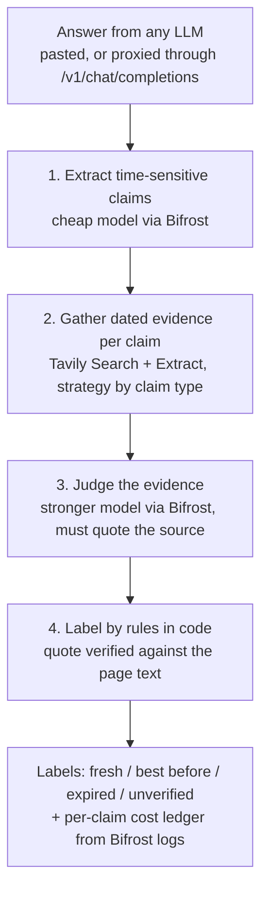
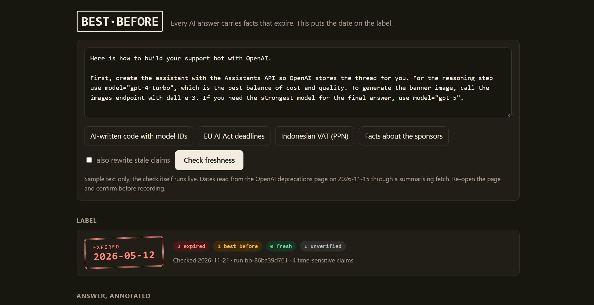
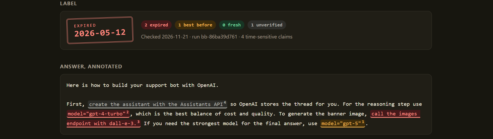
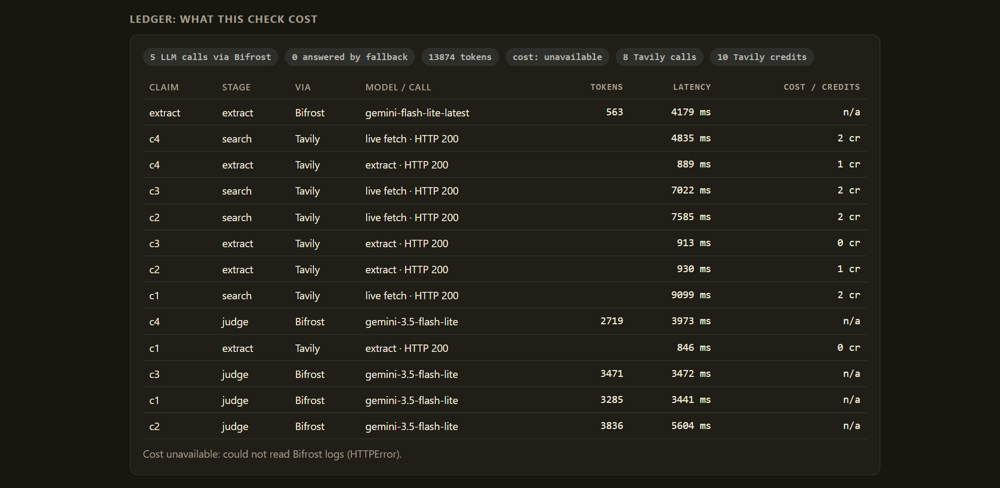
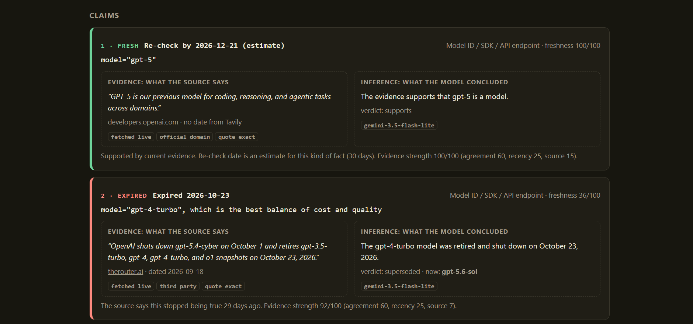

# BestBefore

**Every AI answer carries facts that expire. BestBefore puts the date on the label.**

BestBefore is a freshness layer for AI applications. Point any chatbot at it instead of at the model, and every answer comes back with a label per time-sensitive claim: *fresh*, *best before <date>*, *expired <date>*, or *unverified*, each with a dated source, a verbatim quote, and what replaced it.

Built for the Global AI Hackathon (Geek Room), Problem Statement 06: *Build a Stale-Answer Detector for AI Applications*. It uses **Tavily** for live evidence and **Bifrost by Maxim AI** for every model request.

> **Status (fill in before submitting).** The pipeline, rules, proxy and UI are implemented and covered by an offline test suite (38 tests, stubbed gateways). A live end-to-end run against real Bifrost and Tavily has **not** been recorded in this README yet. After you run it, replace this block with what you observed: models used, one real report, and a screenshot.

## The problem

A language model answers from a snapshot of the world. Code it writes compiles, passes tests and ships, then fails on a calendar date because a model ID was retired. A compliance summary quotes a deadline that an amendment has since moved. Nothing in the text looks wrong.

- Vendors retire models and APIs on fixed dates listed on their deprecation pages ([OpenAI deprecations](https://developers.openai.com/api/docs/deprecations)).
- A 2024 study of 7 LLMs found deprecated API usage in 24.9% to 37.4% of completions, and that fixing after generation worked far better than prompting ([arXiv 2406.09834](https://arxiv.org/html/2406.09834v1)). That is the shape of this product: a check that runs *after* the answer is written.
- Existing factuality scorers label claims supported or unsupported. They do not say *when* a claim stops being true.

## What makes it different

1. **Best-before dates, not just true/false.** A claim that is true today but has an announced end date gets an amber label with the days left. The detector becomes an early warning.
2. **A drop-in proxy.** BestBefore exposes an OpenAI-compatible `/v1/chat/completions`. Change one base URL and an existing app gets labelled answers.
3. **The model never sets the label.** The model reads evidence and must return a verbatim quote. Code checks that the quote really appears in the fetched page, then rules decide the status. A verdict with an unverifiable quote becomes *unverified*.
4. **A different Tavily strategy per kind of fact** (see below), because a deprecation table and a leadership change need different search settings.
5. **A cost ledger per claim**, rebuilt from Bifrost's own request logs.
6. **Optional cross-model agreement.** Two judges from different providers, both through Bifrost; disagreement withholds the label.
7. **A CI mode** that fails a build when code still uses an expired model ID.

## How it works



| Status | Rule | Date shown | Freshness score |
| --- | --- | --- | --- |
| Fresh | Dated or live evidence supports the claim, no end date | Re-check date, clearly marked as an **estimate** from the claim type's volatility | 80 + round(strength × 0.2) |
| Best before | Still true, source states a future end date | The end date **from the source**, with days left | 40 + round(min(days left, 180) / 180 × 39); no date stated: 40 |
| Expired | Source says it was retired, replaced or changed | The date it ended, and the replacement | 39 − round(min(days since, 365) / 365 × 39); no date stated: 0 |
| Unverified | No evidence, undated evidence, conflicting signals, quote not in the source, or evidence strength below 70 | None | none |

Two numbers per claim, never mixed: the **freshness score** says where the claim sits in time; the **evidence strength** (0-100) says how much to trust it: quote match (exact 60, approx 45) + recency (live or ≤30 days 25, then 20/12/5) + source (official domain 15, other 7). Any label needs strength ≥ 70, so an exact quote from an undated third-party page (67) is not enough on its own. Scores are monotonic within a band, and an undated case always gets the conservative edge of its band.

**Quote check.** Quotes are compared as whole tokens (so `gpt-5` never matches inside `gpt-5.1`): *exact* means the tokens appear contiguously; *approx* means ≥85% of them appear in order inside a window at most 1.5× the quote's length. Quotes over 40 tokens are rejected.

## How we use Tavily

Tavily is the only source of evidence. Code: [`bestbefore/tavily.py`](bestbefore/tavily.py), [`bestbefore/verify.py`](bestbefore/verify.py), strategies in [`presets/claim_types.json`](presets/claim_types.json).

| Claim type | Tavily settings | Why |
| --- | --- | --- |
| Model ID / SDK / API | `max_age_hours: 0`, `exact_match`, `include_domains` + `include_domains_mode: "prefer"`, then Extract with `query` | Deprecation tables are updated in place. Tavily's docs warn that `time_range` drops such pages, so we force a live fetch instead |
| Price / plan / quota | `max_age_hours: 0`, Extract `advanced` | Pricing pages change in place; tables need advanced extraction |
| Law / regulation / tax | `search_depth: advanced`, `time_range: year` | Amendments arrive as dated publications |
| Leadership | `topic: news`, `time_range: year`, `exact_match` | Leadership changes are news events |

Handled honestly rather than hidden:

- `published_date` is a beta estimate and can be null; Extract returns no date. We carry the date from Search into Extract, and **undated evidence can never produce a "fresh" label**.
- On the free tier, `max_age_hours` can be refused with HTTP 434. We retry without it and mark the evidence "may be cached".
- If an account rejects newer parameters (HTTP 400), we retry with core parameters and show which strategy was lost.
- Credits per call are read from `usage.credits` and shown in the ledger.

## How we use Bifrost

No file in this repo calls a model provider directly. Code: [`bestbefore/bifrost.py`](bestbefore/bifrost.py), [`bestbefore/ledger.py`](bestbefore/ledger.py).

| Bifrost feature | Used for |
| --- | --- |
| One OpenAI-compatible endpoint, `provider/model` names | Cheap model for extraction, stronger model for judging and rewriting, set in `.env` |
| `fallbacks` on every request | A provider outage does not stop a check; `extra_fields.routing_info.is_fallback` is shown per claim |
| Virtual key (`x-bf-vk`) with budget and rate limits | The app holds no provider keys; 402/429 from governance surface as clear errors |
| `x-bf-lh-run-id`, `x-bf-lh-stage`, `x-bf-lh-claim-id` + `GET /api/logs` | Cost per claim is read back from the gateway's logs, never estimated |
| Cross-model agreement (optional, `MODEL_JUDGE_2`) | The same evidence goes to a judge from a second provider through the same gateway and key; a claim is labelled only when both agree on the class and the end date, otherwise it is unverified |
| Cache headers | Claim extraction may be cached (`x-bf-cache-key`, 10 minute TTL); verdicts are always sent with `x-bf-cache-no-store`, because caching a freshness verdict defeats the purpose |

We ship **no default model IDs**. Hard-coded model names go stale, which is the problem this project detects.

## Setup

Requirements: Python 3.10+, Node or Docker (for Bifrost), a Tavily API key, and one LLM provider key configured inside Bifrost.

```bash
# 1. Start Bifrost (use v2.1.0 or later; do not expose it publicly without auth)
npx -y @maximhq/bifrost            # or: docker run -p 8080:8080 maximhq/bifrost
#    Open http://localhost:8080, add a provider key, create a virtual key with a small budget.

# 2. Install and configure
python -m venv .venv && source .venv/bin/activate
pip install -r requirements.txt
cp .env.example .env               # fill in the virtual key, model IDs, Tavily key

# 3. Run
python run.py                      # http://localhost:8787
python -m pytest -q                # offline tests, no keys needed
```

### Use it as a drop-in proxy

```python
from openai import OpenAI

client = OpenAI(base_url="http://localhost:8787/v1", api_key="unused")
reply = client.chat.completions.create(
    model="provider/model",        # any model your Bifrost can reach
    messages=[{"role": "user", "content": "How do I call the OpenAI API for image generation?"}],
)
print(reply.choices[0].message.content)   # the answer, followed by freshness labels
```

Header `x-bb-mode`: `annotate` (default) appends labels, `rewrite` also corrects stale claims, `off` passes through. The structured report is in the response under `bestbefore`. Streaming is turned off because labels need the whole answer.

### Or fail a build on expired model IDs

```bash
python -m bestbefore.scan src/ --fail-on expired      # exit code 1 if any expired claim is found
python -m bestbefore.scan src/ --fail-on expiring     # stricter: also fail on "best before"
```

Only lines near model or API references are checked, to keep cost down.

### Measure accuracy

```bash
cp eval/claims.template.jsonl eval/claims.jsonl
# check each claim against its source by hand, set "verified_on", add more rows
python -m bestbefore.evaluate eval/claims.jsonl --json eval/results.json
```

Rows without `verified_on` are skipped, so unverified ground truth never counts. "Unverified" predictions are reported as abstentions, separate from wrong labels.

### Or call the checker directly

```bash
curl -s http://localhost:8787/api/check -H 'Content-Type: application/json' \
  -d '{"answer": "Use model=\"gpt-4-turbo\" for this.", "rewrite": true}'
```

## Demo samples

[`demo/answers.json`](demo/answers.json) holds four sample answers. Only the answer text is prepared; every check runs live.

| Sample | What it should show | Verification of the expected result |
| --- | --- | --- |
| Facts about the sponsors | Bifrost "v1 is latest" expired (v2.0.0 on 26 Aug 2026); Tavily "1,000 free credits a month" fresh | Read from both vendors' docs on 15 Nov 2026 through a summarising tool. Confirm before recording |
| AI-written code with model IDs | Three expired claims and one "best before" | Dates read from the OpenAI deprecations page on 15 Nov 2026 through a summarising tool. **Re-open the page and confirm before recording** |
| EU AI Act deadlines | Two moved deadlines, one still correct | From one law-firm alert. Confirm against the Official Journal |
| Indonesian VAT (PPN) | A rate that is neither simply 11% nor 12% | Only the 2025 rule was checked; 2026 changes were not |

## Repository map

```text
run.py                     start the server
bestbefore/server.py       UI, /api/check, OpenAI-compatible proxy
bestbefore/pipeline.py     orchestration, label text, optional rewrite
bestbefore/claims.py       stage 1: claim extraction (Bifrost)
bestbefore/verify.py       stage 2: evidence strategy per claim type (Tavily)
bestbefore/judge.py        stage 3: narrow questions to the judge model (Bifrost)
bestbefore/score.py        stage 4: label rules and scores
bestbefore/bifrost.py      the only door to an LLM
bestbefore/tavily.py       search, extract, free-tier fallbacks
bestbefore/ledger.py       per-claim tokens, latency, credits, cost from Bifrost logs
presets/claim_types.json   claim types, volatility, Tavily strategy and the reason for it
bestbefore/scan.py         CI mode: fail a build on expired model IDs
bestbefore/evaluate.py     accuracy on a hand-verified claim set
eval/                      template for the verified claim set
tests/                     38 offline tests with stubbed gateways
```

## Status: first live runs (21 Nov 2026)

Real runs against a local Bifrost gateway (Gemini provider, free tier) and the Tavily API, on the "AI-written code with model IDs" sample. Nothing below is stubbed.

Models: `gemini/gemini-flash-lite-latest` extracts claims, `gemini/gemini-3.5-flash-lite` judges, with `gemini/gemini-flash-lite-latest` as the Bifrost fallback. The Pro model was not available on the free tier (HTTP 429, limit 0), and `gemini-3.5-flash` took about 32 s for a one-line prompt, which is too slow for the judge.

**Run 1** (run `bb-86ba39d761`), about 23 s end to end:

| Claim in the answer | Label | Source quoted | Replacement |
| --- | --- | --- | --- |
| `model="gpt-5"` | best before 2026-12-11 (20 days left) | developers.openai.com deprecations table, exact quote | gpt-6.1-sol |
| `model="gpt-4-turbo"` | expired 2026-10-23 | developers.openai.com deprecations table, exact quote | gpt-5.6-sol |
| `dall-e-3` | expired 2026-05-12 | quoted from a third-party page restating OpenAI's table | gpt-image-2 / gpt-image-1 |
| Assistants API | unverified (bug, now fixed) | none | none |

Cost of the check: 5 LLM calls through Bifrost (0 answered by fallback), 13,874 tokens, 8 Tavily calls, 10 Tavily credits.





**Run 2** (run `bb-b09c802cfb`) on the same text gave `gpt-4-turbo` and `dall-e-3` the same expired dates. It labelled `gpt-5` **fresh**, though: the judge quoted "GPT-5 is our previous model..." from an OpenAI page instead of the deprecations table. The quote is real, but it does not mention the shutdown date. This is the "judge can misread evidence" limitation below, seen live. A second judge (`MODEL_JUDGE_2`) is the built-in guard against it.



**What the first live run found and fixed**

- `.env` was found from the current folder only. It is now loaded from the project root.
- Bifrost can return `message.content` as a list of parts for Gemini. The check crashed on one claim (`'list' object has no attribute 'strip'`). The parts are now joined into text.
- The claim extractor does not always pick the same sentences: run 1 found 4 claims, run 2 found 3.
- Cost read-back: Bifrost's `GET /api/logs` needs dashboard auth (HTTP 401 with a virtual key), so cost shows "unavailable". Tokens, latency and Tavily credits are still recorded per call.
- The "rewrite stale claims" option can replace the wrong part of a sentence. Treat its output as a draft.

## Limitations

- **Not yet measured.** The evaluation harness exists, but no verified claim set has been run yet. Scores are explained components, not probabilities.
- **The judge can misread evidence.** The quote check catches invented quotes, not a wrong reading of a real one.
- **Dates from Tavily are estimates.** We treat them as a noisy signal and say so in the UI.
- **Re-check dates for fresh claims are estimates** from a per-type volatility setting, not facts.
- **Bifrost log format.** Cost read-back matches logs by run id, stage and claim id. The log record shape varies by Bifrost version; if nothing matches, cost shows "unavailable" rather than a guess.
- **Caching needs a vector store** in Bifrost (for example Redis). Without one the cache headers have no effect.
- **No streaming** through the proxy, and each check adds latency and Tavily credits (roughly 2 to 4 credits per claim with the model-ID strategy by Tavily's price list; not measured).
- **Self-hosted gateway.** Bifrost does not run on serverless hosts. Run the app and the gateway side by side; do not deploy a demo that bypasses it.

## Roadmap

- More vendors' deprecation pages, verified one by one.
- A larger verified evaluation set, and published accuracy (the harness is built; the set is not).
- An MCP tool (`check_freshness`) so agents can label their own drafts.
- Scheduled re-checks: re-run a saved answer when its best-before date arrives.

## AI tools disclosure

- **In the product:** LLMs reached through Bifrost extract claims, judge evidence and optionally rewrite stale claims. List the exact models you ran here.
- **In building it:** Claude (Anthropic) was used for research, design and drafting the code and this README. The author reviewed, ran and is responsible for the submission.

## License

MIT (add a `LICENSE` file before publishing).
